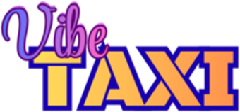

<p align="center">
  
</p>

<h1 align="center">Vibe Taxi (Godot 4)</h1>

<p align="center">
  Top-down arcade taxi driving game where tuning the right music unlocks <strong>Vibe Mode</strong> and drifting.
  <br />
  <a href="https://jaludex.itch.io/vibe-taxi">Play / Download on itch.io</a>
</p>

---

Vibe Taxi is a top-down driving game where you work as a taxi driver with a slow car. Listen closely to your passengers, tune their favorite genre on the radio to enter **Vibe Mode**, boost your speed, unlock drifting, and take 60% less collision damage.

Originally created for *Videogame Programming I (I2026)* at the **Universidad de los Andes (ULA)** in [Python / Pygame](https://github.com/Jaludex/VibeTaxi), this repository is the full **Godot 4.7** multiplatform port.

## Features

- **Game Modes**
  - **Workday:** Earn enough fares before the shift ends to pay the escalating daily fee, repair your taxi between days, and save/resume your run.
  - **Arcade:** Race the clock—every delivery grants bonus time and score, with extra rewards for fast and safe rides.
  - **Zen:** Permanent Vibe Mode, invincibility, and no timer—just cruise the city.
  - **Tutorial:** Dedicated tutorial map plus optional integrated hints for your first shift.
- **Multi-Input Support**
  - **Desktop:** Mouse steering, keyboard shortcuts, and full gamepad support with configurable deadzone.
  - **Mobile (Android):** Native multi-touch HUD with switchable **Virtual Joystick** and **Follow Finger** modes, drift/brake pedals, radio controls, and pause.
- **Interactive Radio & Custom Music**
  - 5 built-in genres (*Rock, Pop, Jazz, Hip-Hop, Electronic*) with lazy OGG streaming.
  - Drop your own `.ogg`, `.mp3`, or `.wav` tracks into `~/Vibe Taxi User Tracks/<genre>` on desktop.
- **Desktop Discord Rich Presence:** Built-in asynchronous IPC client (Linux/Windows/macOS) showing current mode, day/score, and passenger status—toggleable in Options.
- **Localization:** Full **English** and **Español** UI and passenger dialogues (`assets/localization/texts.csv`).
- **Hall of Fame:** Local Top-10 records for Workday and Arcade modes.

## Supported Platforms

| Platform | Package | Notes |
| --- | --- | --- |
| Windows (x64) | `.zip` | Desktop build |
| Linux (x64) | `.zip` | Desktop build |
| macOS (Universal) | `.zip` | Apple Silicon & Intel |
| Web (HTML5) | `.zip` | Recommended for desktop browsers |
| Android (`arm64-v8a`) | `.apk` | Native mobile build |

## Running from Source

### Requirements

- **Godot 4.7+** (`GL Compatibility` renderer)

### Run & Test

```bash
git clone https://github.com/Jaludex/VibeTaxi-Godot.git
cd VibeTaxi-Godot
```

Open `project.godot` in Godot 4.7 and press **F5**, or run the automated headless test suite from the terminal:

```bash
godot --headless --path . --import --quit
godot --headless --path . res://tests/test_runner.tscn
```

## License

Licensed under the [MIT License](LICENSE). Third-party engine, font, and asset notices are documented in [THIRD_PARTY_LICENSES.md](THIRD_PARTY_LICENSES.md).

## Credits

All third-party assets are from copyright-free sources.

### Development & Design
- Jesús León ([Jaludex](https://github.com/Jaludex))
- Zadkiel Jiménez ([Eltoti](https://github.com/zjk-2206))

### Music & Sound Effects
- [Pixabay](https://pixabay.com/es/)
- [OpenGameArt](https://opengameart.org/)
- Text blips by [dmochas](https://dmochas-assets.itch.io/dmochas-bleeps-pack) on itch.io

### Graphical Assets
- Radio, indicator arrow, and passenger UI by Eltoti
- City assets by [nyknck](https://nyknck.itch.io/citypackpixelart) on itch.io
- Car sprites by [Kia](https://kia.itch.io/32x32-car-sprites) on itch.io
- Pedestrian sprites by [vimlark](https://vimlark.itch.io/town-asset-pack-16x16) on itch.io
- Fonts from Google Fonts

### Special Thanks
Thanks to our professors and tutors in the *Videogame Programming I* course at ULA.
